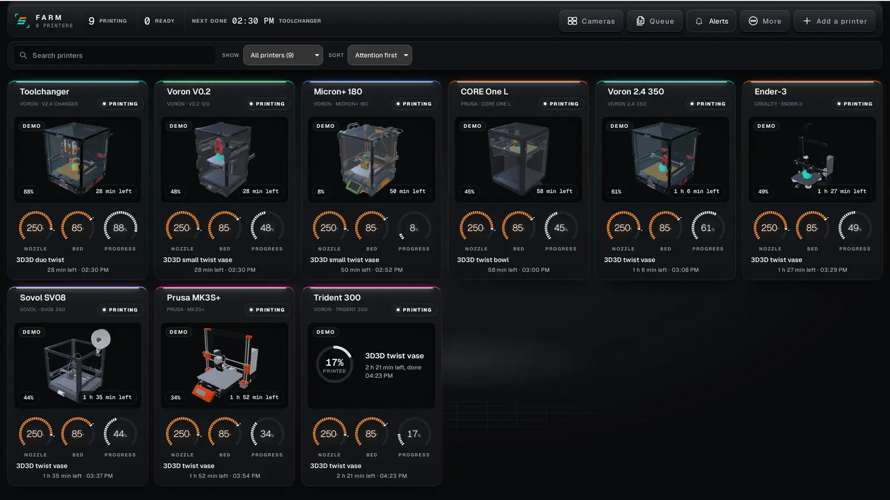
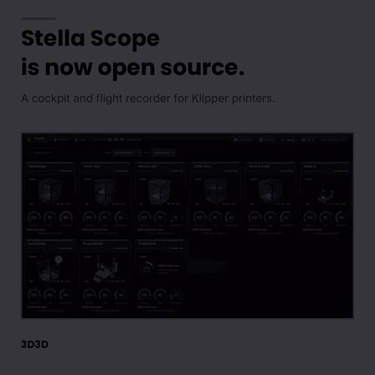
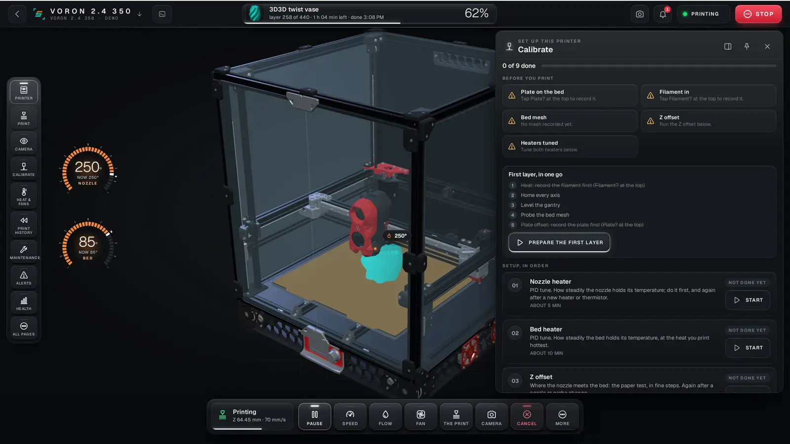
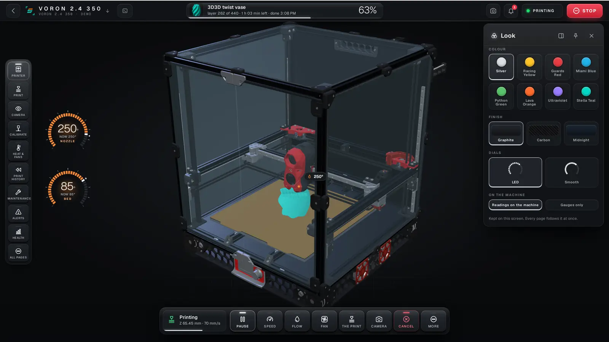

<div align="center">

# Stella Scope

**A cockpit and flight recorder for Klipper, Prusa and FlashForge printers. One wall for the whole farm, every printer in 3D, every moment recorded and replayable.**

[](https://github.com/3d3dcanada/stella-scope-community/actions/workflows/ci.yml)
[](LICENSE)
[](https://github.com/3d3dcanada/stella-scope-community/releases/latest)



</div>

Stella Scope started as a flight recorder for one Voron 2.4. It records everything the printer reports, so that when a print goes wrong you can rewind to the moment it happened and see what the machine was doing. It grew into the tool we run our own print farm with, and it is now fully open source: **AGPL-3.0, no printer limit, no licence key, no account, no cloud.**

Built by [3D3D](https://3d3d.ca) in New Brunswick, Canada, on and for our own farm: a Voron 2.4 R2 350, a Prusa CORE One L, a FlashForge Adventurer 5M and an Anycubic Kobra X.

## Try it in two minutes

You do not need a printer. The demo farm runs nine simulated printers on built-in sample data and never connects to anything.

```sh
git clone https://github.com/3d3dcanada/stella-scope-community.git
cd stella-scope-community
cargo build --release --locked        # Rust 1.91 or newer, Git, a C compiler
./target/release/stella-scope --demo
```

Open <http://127.0.0.1:7420/>. Prefer a package? Linux users can install the `.deb` from the [latest release](https://github.com/3d3dcanada/stella-scope-community/releases/latest) (see [Install](#install)).

<p align="center"></p>

## What it does

**Runs the farm from one wall.** Klipper (Moonraker), Prusa (PrusaLink) and FlashForge (Adventurer 5M and 5M Pro) printers side by side. Each tile is an instrument cluster: state, job, time left, temperatures, the camera and the printer in 3D. Printers are found on your network or added by address.

**A cockpit per printer.** Radial wheels for heat, fans, speed, flow and movement. Material presets grouped by family. The job, the plate and the spool. The machine in 3D with the gantry following the recorded coordinates. Colour is kept for meaning: hot, cold, a warning, an error.


**Rewinds to any moment.** Pick a timestamp and every page shows the machine as it was then. Anything that was not recorded stays marked as unknown. Nothing is filled in or guessed.

**Calibrates step by step.** A pre-print setup, then each calibration your printer supports, in order: PID for nozzle and bed, Z offset, gantry levelling, bed mesh, input shaper and belt comparison, rotation distance, pressure advance and flow. What each step found is kept as a record, and a result can be written into the material it belongs to. On a Prusa: its own self test, first layer, input shaper, phase stepping and nozzle cleaning, run through PrusaLink.



**Keeps every print.** One timelapse picture per layer from the printer's camera, played back inside the print's report with its time, filament, weight, cost, material, plate and everything the printer said while it ran.

**Watches the machine's health over time.** Belt match and resonance from each input-shaper run, each motor driver's current scaling and warnings, and each heater's heat-up speed against its own usual. A slow change shows before it becomes a failed print.

**Remembers your materials.** Twenty editable materials on a fresh install, each with temperatures, density, price per kilogram, pressure advance, flow and fan. A print report turns metres of filament into grams and money.

**Runs a queue.** Add sliced files (`.gcode`, `.bgcode`, `.gcode.3mf`); each is read for the printer, nozzle and material it was sliced for and only goes to a printer that fits. Send files straight from OrcaSlicer or PrusaSlicer with a physical printer of host type OctoPrint. Upload never starts a print by itself.

**Watches for failures.** A local failure watch (Obico's open model, run on your computer) and a plate check before a print. Alerts on the farm floor, and Discord or Slack notices.

**Follows you.** Pair your phone once with a QR code. The Android app reaches Stella Scope directly when it can and through an end-to-end encrypted relay when it cannot.

**Looks the way you like.** Accent colour, finish, dials and chips change on the fly from the Look page.



## Install

### Linux (Debian, Ubuntu, Mint and derivatives)

Download `stella-scope_0.6.3_amd64.deb` and `SHA256SUMS` from the [latest release](https://github.com/3d3dcanada/stella-scope-community/releases/latest), then:

```sh
sha256sum -c SHA256SUMS --ignore-missing
sudo apt install ./stella-scope_0.6.3_amd64.deb
```

### Windows and Android

The open source installers have not been rebuilt yet. The installers on [3d3d.ca/software/stella](https://3d3d.ca/software/stella#download) are older builds that still carry the old five-printer limit. To run without it today, build from source. Windows is the newest platform and has had less use than Linux.

### From source

You need Rust 1.91 or newer, Git and a C compiler. On Linux the desktop window also needs the Tauri system libraries (WebKitGTK 4.1 and libsoup 3).

```sh
cargo build --release --locked        # the recorder and web interface: one binary
./target/release/stella-scope --demo  # try it
```

The desktop app (`desktop/`), the phone link (`link/`) and the Android app (`mobile/`) are separate builds. The [contributing guide](CONTRIBUTING.md#building) shows how.

macOS is not supported yet.

## Connect your printer

Stella Scope reads from each printer over your local network. Nothing is routed through anyone's servers.

| Printer | How it connects | What you need |
|---|---|---|
| **Klipper** (Voron, Ratrig, Ender, anything with Moonraker) | Moonraker, HTTP and WebSocket | The printer's address, for example `http://voron.local:7125`. If Moonraker needs an API key, set `STELLA_MOONRAKER_API_KEY` in the environment. |
| **Prusa** (CORE One, CORE One L, MK4 family) | PrusaLink | The printer's address and its PrusaLink username and password. |
| **FlashForge** (Adventurer 5M, 5M Pro) | The printer's local API | Turn LAN mode on at the printer's screen first, then enter the check code shown there (capital and small letters matter). |

Add printers from the farm wall (**Add a printer**), or under `printers` in the settings file. Printer passwords and access codes are kept in their own files with owner-only permissions, never in the main configuration. `stella-scope --print-config` prints every setting with its default, and [`stella-scope.example.json`](stella-scope.example.json) is a starting point. The [user guide](docs/USER-GUIDE.md) walks through each printer type with pictures.

```sh
cp stella-scope.example.json stella-scope.json   # set moonraker_url to your printer
./target/release/stella-scope --config stella-scope.json
./target/release/stella-scope --replay stella-scope.sqlite3   # read-only rewind of a recording
```

To run it as a service on the printer's host, see [deploy/README.md](deploy/README.md). Nothing there is installed automatically.

## Safe by default

Stella Scope is a recorder first.

- **It does not change your printer by watching it.** Recording and replay never write to Klipper, Moonraker, PrusaLink, macros, firmware or any printer setting.
- **Controls are guarded.** When you run the bare `stella-scope` binary, controls are off unless you set `controls_enabled`, and even then only on a loopback address, never in replay or demo mode. The desktop app turns controls on for you. Every command that changes a printer is shown to you first, with the exact command, and goes out once.
- **No login of its own.** The web interface has none, so keep it on `127.0.0.1` or behind your own network controls. Never expose it to the internet.
- **Nothing is sent to 3D3D** except a feedback message you write and choose to send. Stella Scope downloads only what you ask for (3D models, the optional failure-watch model).
- **Bounded storage.** Retention is bounded (`keep_days`, `max_db_mb`) and the recorder prunes the oldest data first.

Printers have heaters, motors and mains power. You are responsible for supervising your printers and every command you send.

## 3D models

This repository and the program ship **no printer 3D models**. When you add a printer, its tile has a **Get the 3D model** button. Press it and only that printer's model is downloaded, checked against its published SHA-256, and kept on your computer. Each model's licence is shown to you first, and each model keeps its maker's licence. Nothing downloads by itself.

Most models come from the address their authors publish them at, through the catalogue of [3D Print Rig](https://github.com/Psych0h3ad/3d-print-rig) (MIT). A few Prusa machines and a Voron Trident Stealthburner cut have no published file, so 3D3D hosts the converted file with its notice. You can also install a `.glb` or `.glb.gz` you downloaded yourself (**Printer models**, then **Install a file I downloaded**). Without a model, the dials, recorder, calibration and reports all work; only the 3D drawing is empty. See [docs/PRINTER-MODELS-NOTICE.md](docs/PRINTER-MODELS-NOTICE.md).

## How it is built

One synchronous Rust binary: no async runtime, no CDN, a small dependency list, and a web interface embedded in the binary. The recorder stores samples in SQLite and the pages are plain JavaScript modules (the 3D view uses a vendored three.js).

| Path | What it is |
|---|---|
| `src/`, `web/`, `static/` | The recorder, the printer drivers (Moonraker, PrusaLink, FlashForge), the web server and the web interface. |
| `desktop/` | The desktop app (Tauri) for the computer next to the printers: finds them, starts the recorder, the phone link and the failure watch. |
| `mobile/` | The Android app. It dials a paired Stella Scope by key and shows it. |
| `link/` | The phone link: an end-to-end encrypted pipe over [iroh](https://www.iroh.computer/) with NAT traversal and relay fallback. |
| `eye/` | Print-failure detection with Obico's open model, run locally with [tract](https://github.com/sonos/tract). |
| `demo/` | The demo farm's sample prints. |
| `deploy/` | An optional, hand-installed systemd service template. |
| `scripts/`, `tools/` | Test and smoke scripts, and developer tools such as fake printers. |
| `docs/` | The user guide, release notes, licences and notices. |

### Built with AI

Stella Scope is built by one person at 3D3D with AI coding tools, mainly Anthropic's Claude. The design, the direction, the testing on real printers and every decision about what ships are ours; much of the code was written with Claude and then reviewed, tested and run on our own farm before release.

The public history was rewritten in November 2026 to remove personal information that should never have been published (a phone number in a test, personal email addresses and home network details). That cleanup also removed the AI co-author lines from the old commits. It was a privacy fix, not an attempt to hide how the project is made. From now on, commits credit the AI tools that helped write them.

The same rules apply to us as to contributors (see [Using AI tools](CONTRIBUTING.md#using-ai-tools)): whoever submits code is responsible for it. If you find something wrong, please [open an issue](https://github.com/3d3dcanada/stella-scope-community/issues) or a pull request.

## Documentation

- [User guide](docs/USER-GUIDE.md): adding each kind of printer, the cockpit, Calibrate, Materials, print reports, Health, cameras, the queue, the phone and troubleshooting.
- [Quick start](docs/QUICK-START-0.6.3.txt) and [release notes](docs/RELEASE-NOTES-0.6.3.txt) ([0.6](docs/RELEASE-NOTES-0.6.md)).
- [Contributing](CONTRIBUTING.md), [security policy](SECURITY.md), [code of conduct](CODE_OF_CONDUCT.md).
- [Licensing](docs/LICENSING.md), [third-party notices](docs/THIRD_PARTY.md), [printer model notices](docs/PRINTER-MODELS-NOTICE.md).

## Contributing

Bug reports, fixes, new printer support, documentation and ideas are all welcome. Please read [CONTRIBUTING.md](CONTRIBUTING.md) first: it explains how we want issues and pull requests submitted, what we check in review, and how to build and test. The short version:

1. Open an issue before large changes, so we can agree on the approach.
2. Fork, branch from `main`, keep the pull request to one change.
3. Run `cargo fmt`, `cargo test --locked` and the interface tests before you push.
4. Fill in the pull request template. CI must be green.

We do not ask for money. If Stella Scope saves you a print and you want to help, the best contributions are a good bug report with a recording, a fix, or a printer we can test against.

## Roadmap

What is next, and where we would most like help, lives in the [issue tracker](https://github.com/3d3dcanada/stella-scope-community/issues): open source installers for Windows and Android, a macOS build, more tested printers, and cleanup of the old licence code. Issues labelled [`good first issue`](https://github.com/3d3dcanada/stella-scope-community/labels/good%20first%20issue) are the gentlest start.

## Status

Version 0.6.3. It runs daily on our Voron 2.4 R2 350 (Klipper), Prusa CORE One L (PrusaLink) and FlashForge Adventurer 5M. Other printers of those families should work but have not all been tested, so tell us what you find. Known gaps:

- No macOS build, and Windows has had less use than Linux.
- Bambu Lab printers are not supported yet.
- Prusa control is new: it works only while the printer is idle and runs each command as a small file the printer prints.
- The timelapse needs a camera the camera hub can read. Motor health needs drivers that report their state (Klipper TMC drivers); Prusa and FlashForge printers do not.
- Some 3D models are schematic where no open-licence file exists.

## Licence

[GNU Affero General Public License v3.0](LICENSE). Copyright 2025-2026 3D3D Canada.

The failure-detection scoring in `eye/` follows Obico's open-source implementation ([obico-server](https://github.com/TheSpaghettiDetective/obico-server), AGPL-3.0), and Obico's model weights are not stored in this repository: `stella-eye` loads an ONNX file you point it at with `--model`. Printer models keep their own licences. Klipper, Moonraker, Voron, Prusa, PrusaLink, FlashForge and Obico are the work and marks of their own owners; Stella Scope is not affiliated with them.
